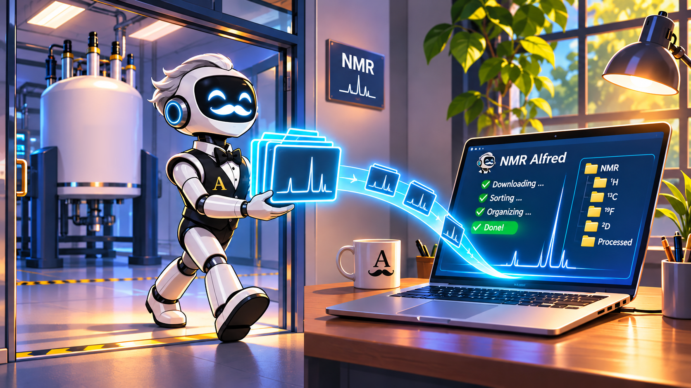
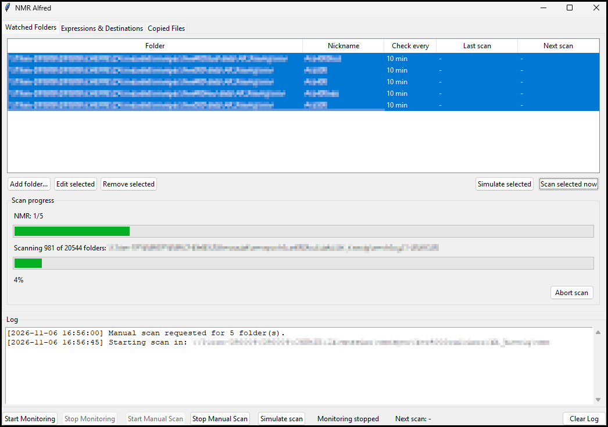
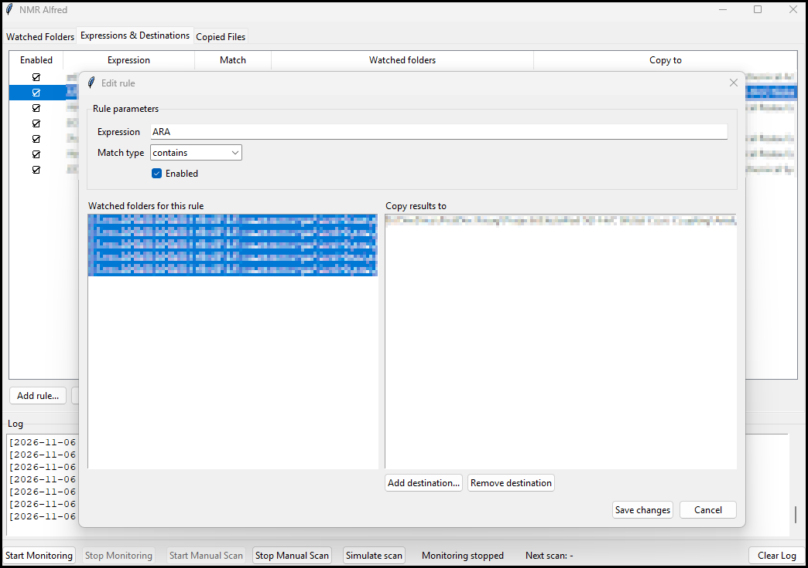
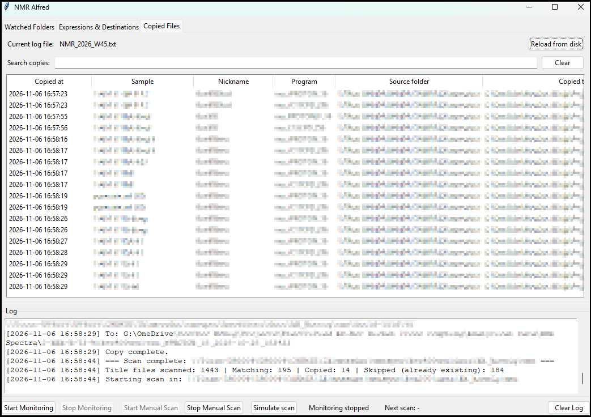

## NMR-Alfred

Alfred is your personal tool for automatically downloading and organizing NMR measurements from Bruker NMR spectrometer servers.

- Select the institutional folders where completed measurements are stored.
- Define rules to specify which NMR files to copy and where to save them.
- Enable automatic monitoring to check for completed measurements at a chosen interval.
- Set it up only once for your entire research group.

Alfred finds measurements that match your rules (e.g. measurements containing your name or experiment code) and copies them to your destination folder(s).
It names the destination sub folders after the corresponding measurements and organizes them by NMR device, measurement type, date, and time.

Alfred never overwrites existing files.

## Screenshots

## Watched NMR Folders

## Rules and Copy Destination(s)

## Copied Files Log

